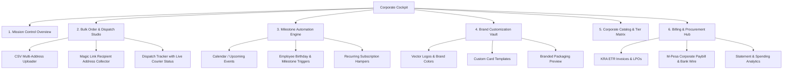

# TouchGift Corporate Gifting Cockpit & B2B Portal Blueprint

## 1. Executive Summary & Vision

The **TouchGift Corporate Cockpit** transforms corporate gifting from a manual, high-friction WhatsApp back-and-forth into an autonomous, sleek self-serve dashboard for HR teams, executive assistants, procurement officers, and marketing leads in Kenya.

Instead of treating corporate gifting as individual consumer retail checkouts, the Cockpit provides an **all-in-one mission control** for bulk gifting, multi-address dispatches, automated milestone celebrations (employee birthdays, work anniversaries, client onboarding), company branding customization, and instantaneous B2B invoicing/quotations.

---

## 2. Core Personas & Problem-Solution Fit

| Persona | Core Pain Points | Cockpit Solution |
| :--- | :--- | :--- |
| **HR People & Ops Leads** | Forgets employee birthdays & work anniversaries; manual address collection is exhausting. | **Milestone Automation Engine** + Employee CSV/Slack/HRIS sync & Magic Address Claim Links. |
| **Executive Assistants & C-Suite** | Needs 30–100 premium executive hampers delivered for Christmas/End-of-Year with zero hassle. | **Bulk Dispatches Wizard** with 1-click CSV upload and multi-recipient tracking. |
| **Marketing & Client Success** | Needs branded VIP swag & luxury gifts sent to top tier enterprise clients. | **Brand Asset Vault** (upload logos, ribbon styles, engraved message cards) + real-time 3D mockups. |
| **Finance & Procurement** | Needs ETR compliant tax invoices, KRA PIN validation, LPOs, and corporate payment terms (M-Pesa Paybill / Bank Wire / 30-Day terms). | **B2B Billing Center** with instant PDF proforma invoices, ETR receipts, and split payment tracking. |

---

## 3. Architecture & Information Structure

The Cockpit is structured under an authenticated, clean enterprise route: `touchgiftshop.co.ke/corporate/cockpit` (with public marketing on `/corporate`).

---

## 4. Detailed Feature Specifications

### 4.1 Mission Control (Dashboard Home)
* **High-Level KPI Cards:**
  * **Active Orders & Dispatches:** (e.g., *48 gifts in transit across Nairobi*).
  * **Upcoming Milestones:** (e.g., *4 birthdays next week*).
  * **Gift Credits & Budget Utilized:** (e.g., *KSh 240,000 / KSh 500,000 corporate credit line*).
  * **Delivery Success Rate:** (*99.4% first-attempt success*).
* **Live Dispatch Timeline:** Real-time progress bar of live deliveries with direct courier check-in and delivery confirmation photos.
* **Quick Launch Action Bar:**
  * `[+ Create Bulk Order]`
  * `[+ Send Instant VIP Gift]`
  * `[+ Upload Employee List]`
  * `[Request Custom Quote / Concierge Call]`

---

### 4.2 Bulk Order & Dispatch Studio (The Game Changer)
Standard retail carts break when sending to more than one address. The Studio solves this completely:
1. **Curate the Gift Box:**
   * Select an existing curated collection (e.g., *Executive Safari Box, Nairobi Artisanal Tea & Honey, Wellness Retreat*).
   * Or build a custom hamper with MOQ indicators (e.g., minimum 10 units for branded items).
2. **Flexible Recipient Input (Two Modes):**
   * **Mode A: CSV / Excel Upload:** Download template, paste names, phone numbers, delivery locations (building, estate, floor, Nairobi area), and custom note. Auto-validates Kenyan phone formats (+254 / 07... / 01...).
   * **Mode B: Magic Address Links ("Gifter sends link, recipient enters address"):** The company uploads recipient emails/WhatsApp numbers. TouchGift automatically messages them: *"ACME Corp has sent you a gift! Choose your delivery address & delivery time."* No more outdated address lists.
3. **Dispatch Schedule:**
   * Single drop: All delivered on a specific date (e.g., Dec 20 for Christmas).
   * Rolling drops: Delivered on individual anniversaries or dates.

---

### 4.3 Brand Customization Vault
Corporate buyers buy TouchGift because it makes **them** look world-class.
* **Brand Asset Upload:**
  * High-res vector SVG/PNG logo upload.
  * Corporate primary and secondary hex colors.
* **Packaging Customizations:**
  * Debossed or hot-foil logo on magnetic presentation box lid.
  * Custom branded woven ribbon.
  * Heavyweight foiled gift card with company letterhead, handwritten fountain-pen fonts, or printed digital greeting.
* **3D Visualizer / Live Preview:**
  * Dynamic preview showing how their logo and greeting card render on the actual selected gift box.

---

### 4.4 Automated Milestones & Calendar Sync
* **Calendar View:** Shows a monthly calendar with company holidays, employee birthdays, quarterly reviews, and partner appreciation dates.
* **Smart Reminders:** WhatsApp/Email notification 7 days prior: *"You have 3 team birthdays next week. Do you want TouchGift to dispatch the Gold Celebration Box automatically?"*
* **Set-and-Forget Rules:** Option to auto-approve gifts under a set budget (e.g., auto-ship KSh 6,500 box on any employee's 1-year anniversary).

---

### 4.5 Billing, Procurement & Kenyan Compliance
Designed specifically for Nairobi business purchasing practices:
* **Instant Proforma Invoicing:** Generate an official PDF proforma quote in 1 click to submit to internal finance for approval before funds are released.
* **KRA Pin & ETR Receipt Integration:** Fields for Company PIN, VAT deduction, and auto-generated TIMS/ETR compliant receipts.
* **Payment Methods Built for Kenya:**
  * Corporate M-Pesa Paybill / Till direct checkout with STK push or manual reference confirmation.
  * Bank Wire / RTGS / EFT transfer instructions with instant order reservation.
  * 30-Day Invoicing for approved enterprise accounts.

---

## 5. Visual Design & HCI Standards (Cockpit UI)

| Element | Specification |
| :--- | :--- |
| **Theme / Aesthetic** | Deep executive dark-slate / obsidian `#0A0D12` or ultra-clean enterprise pearl `#F9FAFB` with warm gold accents (`#D4AF37` / `#C5A059`) and crisp emerald status badges (`#10B981`). |
| **Typography** | Premium display serif (`Playfair Display` or `Cinzel`) for section headers paired with high-legibility geometric sans (`Plus Jakarta Sans` or `Inter`) for tables, numbers, and data feeds. |
| **Information Density** | High signal-to-noise ratio. Clean data tables with sorting, filtering, badge statuses (*Draft, Pending Approval, Packing, Out for Delivery, Delivered*). |
| **Affordance & Polish** | Destructive actions (e.g., Cancel Dispatch) in consequence-matched warning states with confirmation modal; zero ambiguous icons—all buttons include clear labels. |
| **Mobile Adaptability** | Executives often approve budgets on their iPhones while in meetings. Fully responsive mobile dashboard with simplified card stacks and WhatsApp quick-share triggers. |

---

## 6. Phased Rollout Plan

1. **Phase 1: High-Converting Public B2B Page + Quotation Engine (Immediate)**
   * Launch revamped `/corporate` with clear tiered packages, MOQ details, and instant quote generator with direct WhatsApp handoff.
   * Fix navbar navigation to route directly to `/corporate`.
2. **Phase 2: Self-Serve Bulk CSV Dispatcher & Magic Link Collector**
   * Multi-address CSV uploader and recipient address intake portal.
   * Proforma invoice and ETR PDF generator.
3. **Phase 3: Full Cockpit Dashboard & Milestone Automation**
   * Account authentication, team member access, recurring employee anniversary triggers, and brand asset library.
